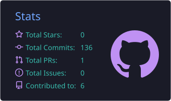
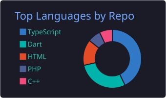
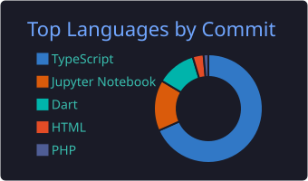
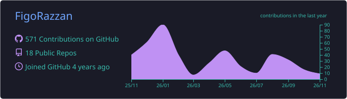

<div align="center">


<br/>


<br/>


<a href="https://figorazzan-portofolio.vercel.app">
  
</a>
<a href="https://www.linkedin.com/in/figorazzan/">
  
</a>
<a href="mailto:figorazzan10@gmail.com">
  
</a>
<a href="https://github.com/FigoRazzan?tab=followers">
  
</a>
<a href="https://github.com/FigoRazzan">
  
</a>

</div>

---

## 🧑‍💻 About Me & Engineering Profile

> **Informatics Graduate (B.Sc. / S1)** from **Institut Teknologi Nasional (ITENAS) Bandung** (`Sep 2022 – Sep 2026`, **GPA 3.52 / 4.00 — High Distinction**). My work bridges **AI & Natural Language Processing** with **scalable Full-Stack Web (Next.js, TypeScript, PostgreSQL)** and **Cross-Platform Mobile & Mixed Reality (Flutter, Unity 3D)** to ship digital products that are fast, secure, and genuinely useful.

```typescript
const figo: EngineerProfile = {
  fullName:   "Muhammad Figo Razzan Fadillah",
  location:   "Bandung, West Java, Indonesia (UTC+7)",
  status:     "S1 Informatics Graduate — Open to Software Engineering, Full-Stack & AI/ML Roles",

  education: {
    institution: "Institut Teknologi Nasional (ITENAS) Bandung",
    degree:      "Bachelor of Computer Science / S1 Informatika (2022 – 2026)",
    gpa:         "3.52 / 4.00 (Very Satisfactory / High Distinction)",
    focus:       ["Artificial Intelligence", "NLP & Deep Learning", "Full-Stack Architecture"],
  },

  leadership: {
    role:        "Chief Technology Officer (CTO) & Lead Full-Stack Developer",
    platform:    "Ezwift Connect (March 2025 – Present)",
    highlights:  [
      "End-to-end Next.js, TypeScript, Prisma & PostgreSQL system architecture",
      "Automated Escrow payment workflow & low-latency Socket.io real-time chat",
      "Self-managed production Linux VPS, Nginx reverse proxy & SSL hardening",
    ],
  },

  milestones: {
    thesisAI:    "97.19% Test Accuracy • Tri-Modal Stacking (IndoBERTweet + XGBoost)",
    nationalIP:  "Registered Software Copyright (HKI No. 001020339) • Kemenkumham RI",
    grantAward:  "Kemendiktisaintek National PKM Grant 2025 Recipient (510 Logged Hours)",
  },

  portfolio:  "https://figorazzan-portofolio.vercel.app",
};
```

<br/>

<table>
  <tr>
    <td width="33%" valign="top">
      <h4 align="center">🧠 AI, Deep Learning & NLP</h4>
      <p align="center">
        Transformer fine-tuning (<b>IndoBERTweet</b>), gradient boosted ensembles (<b>XGBoost</b>), Indonesian NLP pipelines (<b>Sastrawi + TF-IDF</b>), LLM API integration (<b>Mistral AI</b>), and automated data pipelines (<b>Playwright & GraphQL</b>).
      </p>
    </td>
    <td width="33%" valign="top">
      <h4 align="center">🌐 Full-Stack Web & Infra</h4>
      <p align="center">
        Production web systems with <b>Next.js (App Router)</b>, <b>React</b>, <b>TypeScript</b>, <b>Tailwind CSS</b>, <b>PostgreSQL + Prisma</b>, real-time <b>Socket.io</b>, <b>Python Flask</b>, and self-managed <b>Linux VPS / Nginx / Docker</b>.
      </p>
    </td>
    <td width="33%" valign="top">
      <h4 align="center">📱 Mobile & Mixed Reality</h4>
      <p align="center">
        Google-certified <b>Flutter & Dart</b> apps with encrypted local-first persistence (<b>GetStorage</b>), plus multiplayer <b>Mixed Reality (Passthrough)</b> software on <b>Meta Quest 3</b> using <b>Unity 3D, C# & Netcode</b>.
      </p>
    </td>
  </tr>
</table>

---

## 🚀 Featured Work & Case Studies

> Full interactive mockups, design breakdowns, and downloadable ATS CVs (EN/ID) are available on [**figorazzan-portofolio.vercel.app**](https://figorazzan-portofolio.vercel.app).

### 1. ⚡ Ezwift Connect & Ezwift Connect 2.0 — *Academic Network & Research Marketplace*
`CTO, Lead Full-Stack Developer & UI/UX Architect` · `March 2025 – Present` · [Case Study ↗](https://figorazzan-portofolio.vercel.app/projects/ezwift-2)

Ezwift Connect is an academic social network and secure digital marketplace built for researchers and university students to publish, collaborate, and monetize scholarly assets safely.

<table>
  <tr>
    <td width="50%" valign="top">
      <b>Core Platform & Security Engineering (v1.0)</b>
      <ul>
        <li><b>Automated Escrow Payments:</b> Holds buyer funds securely until digital deliverable verification before triggering automated payouts & digital wallet tracking.</li>
        <li><b>Real-Time WebSocket Chat:</b> Low-latency <b>Socket.io</b> messaging with live typing indicators and online presence tracking.</li>
        <li><b>Document Previews & Infra:</b> Built-in PDF excerpt previews for buyers; independently provisioned production <b>Linux VPS</b> with <b>Nginx</b>, SSL, and <b>PostgreSQL / Prisma ORM</b>.</li>
      </ul>
    </td>
    <td width="50%" valign="top">
      <b>UI/UX & Frontend Architecture Revamp (v2.0)</b>
      <ul>
        <li><b>Substack-Style Editorial Feed:</b> Distraction-free long-form research reading with typography hierarchy, <i>Populer di Ezwift</i>, <i>Rekomendasi Penulis</i>, Free/Premium tags, bookmarks & view counters.</li>
        <li><b>"Cerita Anda" Microblogging (X / Threads Style):</b> Lightweight daily status stream with instant reload-free composer, university affiliation tags, verified badges & optimistic micro-reactions.</li>
      </ul>
    </td>
  </tr>
</table>

**Stack:** `Next.js` · `TypeScript` · `Tailwind CSS` · `Node.js` · `Socket.io` · `Prisma ORM` · `PostgreSQL` · `Linux VPS` · `Nginx`

---

### 2. 🤖 X Buzzer Detection System — *Undergraduate Thesis Research (ITENAS)*
`End-to-End Machine Learning & Full-Stack Engineer` · `January 2026 – July 2026` · [Case Study ↗](https://figorazzan-portofolio.vercel.app/projects/buzzer)

An AI-powered multi-modal web platform detecting coordinated political buzzer accounts on platform **X** (case study: *Makan Bergizi Gratis / MBG* public policy), resilient against both slang camouflage and purchased fake followers.

| Benchmark Metric | Result | Research Significance |
| :--- | :---: | :--- |
| **Test Accuracy** | **`97.19%`** | Peak performance achieved via Hybrid Late Fusion Stacking |
| **F1-Score** | **`94.68%`** | `+4.90%` over Metadata-only & `+2.81%` over Text-only baselines |
| **Precision / Recall** | **`96.17% / 93.24%`** | High detection certainty without over-flagging organic users |
| **False Positive Control** | **`11 / 1,102 Accounts`** | Minimal wrongful classification across organic citizen accounts |
| **Experimental Scale** | **`270 Iterations`** | Grid tuning across XGBoost, 3 split ratios & balanced/imbalanced sets |

**Tri-Modal Stacking Ensemble Architecture & Interactive Testbench:**
- **01 · Linguistic Expert (`IndoBERTweet`):** Analyzes tweet semantics, tone, coordinated hashtags, and Indonesian slang to output `prob_teks`.
- **02 · Behavioral Expert (`XGBoost`):** Evaluates **11 account activity metrics** (account age, follower/following ratios, daily tweet rates, script duplication index, suspicion score) to output `prob_metadata`.
- **03 · Meta-Classifier (`XGBoost Late Fusion`):** Combines `prob_teks`, `prob_metadata`, and all **11 raw behavioral features (13 unified inputs)** for calibrated final verdicts.
- **Live Web App (`Next.js` + `Playwright`):** Features automated live profile & 20-tweet scraping via **Playwright + GraphQL**, 11-parameter *what-if* sliders, one-click preset simulations (`@beritanasional_id`, `@warga_biasa99`, `@pasukan_pembela77`), and a 3-scenario side-by-side comparison dashboard.

**Stack:** `Python` · `PyTorch` · `IndoBERTweet` · `XGBoost` · `Scikit-Learn` · `Playwright` · `Next.js` · `TypeScript` · `Tailwind CSS`

---

<table>
  <tr>
    <td width="50%" valign="top">

### 3. 💙 KonselQ — *AI Student Mental Health App*
`Mobile & AI Integration Engineer` · `May 2025 – Dec 2025` · [Case Study ↗](https://figorazzan-portofolio.vercel.app/projects/konselq)

Privacy-first cross-platform mobile companion helping university students navigate academic stress, overthinking, and anxiety 24/7.

- **NaraAI Conversational Assistant:** Integrated **Mistral AI LLM** via REST API for warm, empathetic preliminary counseling responses.
- **Local-First Encrypted Privacy:** Implemented on-device encrypted persistence via **GetStorage** — **100% user anonymity** with zero external server tracking.
- **Wellness Modules:** Guided *Swaperiksa* mental self-assessments, educational guides, and private local session history logs.

**Stack:** `Flutter SDK` · `Dart` · `Mistral AI API` · `GetStorage` · `Local Encryption`

</td>
<td width="50%" valign="top">

### 4. 🥽 Aurora Room (MR Solar System) — *PKM Grant 2025*
`QA & 3D Asset Integrator` · `2025` · [Demo Video ↗](https://youtu.be/YBscU5P_Q0Y) · [Case Study ↗](https://figorazzan-portofolio.vercel.app/projects/pkm-mr)

Multiplayer **Mixed Reality** astronomy learning software on **Meta Quest 3**, funded by **Kemendiktisaintek RI** (**510 logged work hours**) and piloted at SDIT Daarul Jihad.

- **Official Intellectual Property:** Protected by **Registered Software Copyright (HKI No. 001020339)** from the Ministry of Law & Human Rights RI.
- **Spatial & Multiplayer Tech:** Built with **Unity 3D**, **C#**, **Quest 3 Passthrough**, **OpenXR**, hand-tracking grab mechanics, orbital angle validation & **Netcode for GameObjects** classroom sync.
- **Impact & Optimization:** Draw-call batching & LOD optimization for steady FPS; achieved **4.28 / 5.00** (*Highly Satisfactory*) student field evaluation score.

**Stack:** `Unity 3D` · `C#` · `Meta Quest 3` · `Netcode` · `Oculus SDK` · `OpenXR`

</td>
  </tr>
</table>

---

### 5. 🩺 TanyaSehat — *Indonesian NLP Health Expert System*
`NLP & Full-Stack Developer` · `Dec 2024 – Feb 2025` · [Source Repo ↗](https://github.com/FigoRazzan/tanyasehat) · [Case Study ↗](https://figorazzan-portofolio.vercel.app/projects/tanyasehat)

Decoupled web-based preliminary diagnostic platform translating everyday Indonesian symptom descriptions into structured top-K predictions, confidence scores, and first-aid guidance.

- **Indonesian NLP Pipeline:** Text cleaning, tokenization, stopword removal, **Sastrawi Stemmer** (handling Indonesian affixes), **TF-IDF** vectorization, and **Naive Bayes** classification.
- **Voice Accessibility & Typo-Resilient Chatbot:** Integrated browser **Web Speech API** (Indonesian Speech-to-Text) plus an interactive Q&A health chatbot using **fuzzy matching** & medical synonym dictionaries.
- **Extensible Backend:** Modular **Next.js 15** frontend + **Python Flask** REST API with JSON disease schemas and `/api/train` model retraining endpoint.

**Stack:** `Next.js 15` · `TypeScript` · `Tailwind CSS` · `Python` · `Flask` · `NLTK` · `Sastrawi` · `Scikit-Learn` · `Web Speech API`

---

## 📦 Public GitHub Repositories

Beyond private production & research codebases, here are my active public repositories on GitHub:

| Repository | Focus | Key Technologies |
| :--- | :--- | :--- |
| [**`tanyasehat`**](https://github.com/FigoRazzan/tanyasehat) | Indonesian NLP disease detection expert system & Speech-to-Text assistant | `Next.js 15` `Flask` `Sastrawi` `TF-IDF` `Naive Bayes` |
| [**`Sistem-Pos-GAS-LPG`**](https://github.com/FigoRazzan/Sistem-Pos-GAS-LPG) | WEB-GAS — LPG gas ordering, distribution & POS web information system | `Next.js 16` `TypeScript` |
| [**`cinesync-fe`**](https://github.com/FigoRazzan/cinesync-fe) & [**`cinesync-be`**](https://github.com/FigoRazzan/cinesync-be) | Cine-Sync — Integrated B2B & B2C cinema transaction system (*Secure by Design*) | `TypeScript` `React / Next.js` `NestJS` |
| [**`DL-MultiArchitecture-Experiment`**](https://github.com/FigoRazzan/DL-MultiArchitecture-Experiment) | Comparative benchmark of Transformer, BiLSTM-Attention & SOM architectures (BBCNews, Sentiment140, FordA) | `Python` `Deep Learning` |
| [**`Analisis-Sentimen-dan-Regresi-Ulasan`**](https://github.com/FigoRazzan/Analisis-Sentimen-dan-Regresi-Ulasan) | CRISP-DM sentiment classification & rating regression app for *Wondr by BNI* reviews | `Python` `Streamlit` `Scikit-Learn` |
| [**`Text-to-Speech-Method-Comparison`**](https://github.com/FigoRazzan/Text-to-Speech-Method-Comparison) | Comparative study of Concatenative, SPSS-HMM & Neural TTS synthesis | `Python` `Speech Synthesis` |
| [**`Speech-Color-Recognition`**](https://github.com/FigoRazzan/Speech-Color-Recognition) | Indonesian spoken color recognition system using DTW & HMM | `Python` `DTW` `HMM` |
| [**`UAS-Public-Health-Dashboard`**](https://github.com/FigoRazzan/UAS-Public-Health-Dashboard) | Interactive global COVID-19 monitoring & epidemiological visualization dashboard | `React` `TypeScript` |

---

## 🏆 Honors, Intellectual Property & Certifications

### 📜 Honors, Grants & Legal IP
- **Official Computer Program Copyright (HKI)** — *"Aurora Room"* Mixed Reality Educational Software · **Reg. No. `001020339`** (`HKI.2.01.02.02-.007750/2025`) · Directorate General of Intellectual Property (DJKI), Ministry of Law & Human Rights RI *(Dec 2025)*
- **National PKM Grant Recipient 2025** — Community Partnership Empowerment Scheme · Ministry of Higher Education, Science & Technology (**Kemendiktisaintek RI**) *(Jul 2025)*
- **Undergraduate AI Thesis Distinction** — Tri-Modal Stacking Ensemble (`97.19%` Accuracy) · Institut Teknologi Nasional Bandung *(2026)*

### 🎓 Technical Certifications

| Certification | Issuing Organization | Period / Validity | Credential |
| :--- | :--- | :---: | :--- |
| **Basics of Artificial Intelligence** | Dicoding Indonesia *(Google Cloud Partner)* | Dec 2024 – Dec 2027 | [Verify `98XW595Y9PM3` ↗](https://www.dicoding.com/certificates/98XW595Y9PM3) |
| **Building Flutter Mobile Apps for Beginners** | Dicoding Indonesia *(Google Developers Partner)* | Dec 2024 – Dec 2027 | [Verify `RVZKG9MMOXD5` ↗](https://www.dicoding.com/certificates/RVZKG9MMOXD5) |
| **Getting Started with Dart Programming** | Dicoding Indonesia *(Google Developers Partner)* | Dec 2024 – Dec 2027 | [Verify `MRZMYMYONZYQ` ↗](https://www.dicoding.com/certificates/MRZMYMYONZYQ) |
| **HCIA-Security V4.0 (Huawei Certified ICT Associate)** | Huawei Talent Online *(Huawei Technologies)* | Aug 2024 | Network Security, Firewall & VPN |
| **Python Programming Basics** | Huawei Talent Online *(Huawei Technologies)* | Nov 2023 | Python 3, Data Structures & Algorithms |

---

## 💻 Tech Stack & Engineering Toolbox

<div align="center">

### 🧠 AI, Machine Learning & NLP


### 🌐 Web, Backend & Databases


### 📱 Mobile, Mixed Reality & DevOps


</div>

---

## 📊 GitHub Analytics

<div align="center">




<br/>




<br/>



</div>

---

## 🐍 Contribution Snake

<div align="center">


<br/>


<br/>

<picture>
  <source media="(prefers-color-scheme: dark)" srcset="https://raw.githubusercontent.com/FigoRazzan/FigoRazzan/output/github-snake-dark.svg" />
  <source media="(prefers-color-scheme: light)" srcset="https://raw.githubusercontent.com/FigoRazzan/FigoRazzan/output/github-snake.svg" />
  
</picture>


</div>

---

## 📫 Let's Connect

<div align="center">

Open to **Software Engineer**, **Full-Stack Developer**, **AI/ML Engineer**, and **Mobile Developer** opportunities or technical collaborations.

<br/>

<a href="https://figorazzan-portofolio.vercel.app">
  
</a>
<a href="https://www.linkedin.com/in/figorazzan/">
  
</a>
<a href="mailto:figorazzan10@gmail.com">
  
</a>
<a href="https://www.instagram.com/figorazzan_">
  
</a>

<br/><br/>

```text
📍 Bandung, West Java, Indonesia (UTC+7)
🎓 B.Sc. in Informatics — Institut Teknologi Nasional Bandung (GPA 3.52 / 4.00)
🌐 Live Portfolio & ATS CV: https://figorazzan-portofolio.vercel.app
```

<br/>


</div>
